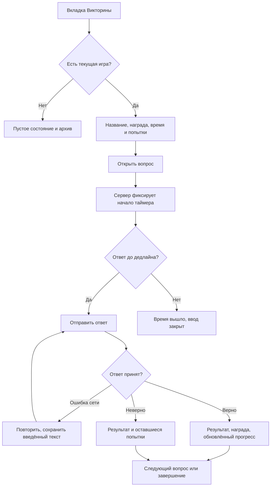
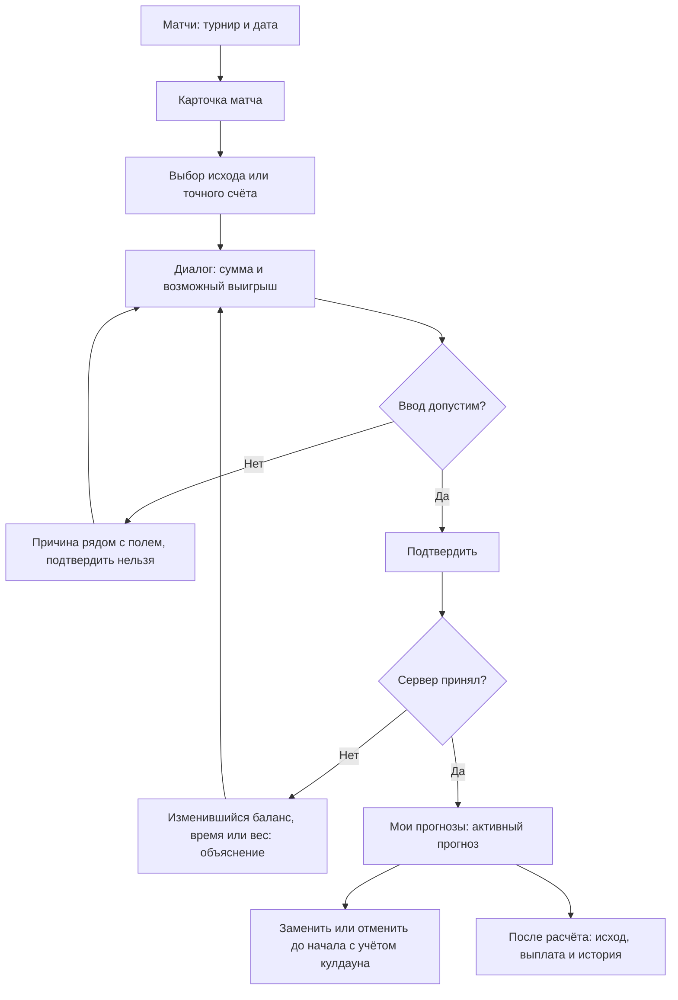
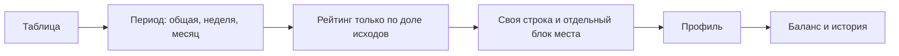

# TOTS · этап 7.1 · сценарии, wireframes и дизайн-система

Дата: 20 ноября 2026. Задача: #8. Проектирование на основе текущих webapp/index.html, style.css, app.js и docs/progress.md. Макет: design-preview.html. Это дизайн-пакет для реализации 7.2–7.7; рабочие экраны и сервер не изменены.

## Принципы

1. Одна страница состоит из самостоятельных секций. Между секциями 24 px видимого холста; внутри 16–20 px. Секции нельзя соединять общей заливкой на всю страницу.
2. У каждого блока есть задача и заголовок. Цвет дополняет структуру, а не заменяет её: в монохромном wireframe границы и группировка сохраняются.
3. Главное действие одно на текущем шаге. Цвет акцента используется для действия/выбора; успех и ошибка сопровождаются текстом.
4. Прогресс квалификации — информация; карточка игры — действие; правила — справка; архив/история — список. Для каждой роли своя поверхность.
5. BIST не смешиваются с очками рейтинга. Баланс и квалификация показаны отдельно от числа ответов и доли исходов.

## Информационная архитектура

- Общая шапка: бренд и компактный баланс. Нижняя навигация: Викторины / Прогнозы / Таблица / Профиль.
- Викторины: квалификация → текущая игра → правила → архив → отдельный вход в админку для администратора.
- Прогнозы: Матчи / Мои прогнозы → турниры и даты → карточки матчей → пояснение правил. Диалог выбора содержит сумму, исход, выплату и подтверждение.
- Таблица: период → участники по доле исходов → своё место → определение показателей. Переключателя сортировки нет.
- Профиль: идентичность → баланс и суммы операций → история. Ник нельзя менять. Админка и дашборд не вклиниваются в личную историю.

## User flow: викторина

До открытия вопроса таймер не идёт. До завершения викторины правильный ответ не раскрывается. Макет использует отдельный демонстрационный вопрос с раскрытием ответа для проверки обратной связи; это не правило рабочего приложения. Серверная проверка и защита от повторной награды сохраняются при реализации.

## User flow: прогноз

Выплата показывается до подтверждения; операция блокируется на время отправки. Отмена возвращает ставку; замена показывает предыдущий прогноз и новую сумму. Просроченные веса и начало матча — текстовые причины запрета, не просто серая кнопка. В демонстрации доступен исход; точный счёт остаётся существующим сценарием приложения и требует отдельного макета сетки в 7.5.

## User flow: рейтинг и профиль

Доля исходов показывается после 6 рассчитанных прогнозов на исход. При равенстве — число угаданных исходов, затем дата регистрации. Ответы в викторинах — только статистика. Для чужого профиля история операций скрыта.

## Wireframes: порядок блоков

| Экран | Блок 1 | Блок 2 | Блок 3 | Вторичные зоны |
|---|---|---|---|---|
| Викторины | Прогресс квалификации | Текущая игра и CTA | Архив | Правила; отдельный вход администратора |
| Прогнозы | Переключатель и фильтры | Карточки матчей / мои прогнозы | Условия приёма | Диалог выбора и подтверждения |
| Таблица | Период и сортировка | Список участников | Своё место | Значение показателей |
| Профиль | Идентичность | Баланс | История | Ник только для просмотра; админские инструменты отдельно |

Режим Wireframe использует ту же разметку и те же переходы, убирая цветовую и декоративную составляющую. Подписи блоков помогают оценить иерархию. На телефоне обзор сценария расположен над макетом; в рабочем приложении этой проектной панели не будет.

## Дизайн-система v0.1

### Семантическая палитра

| Роль | Тёмная | Светлая | Назначение |
|---|---|---|---|
| Холст | #0D131B | #E8EDF3 | Отделяет секции свободным пространством |
| Карточка | #1B2737 | #FFFFFF | Данные, списки, идентичность |
| Вложенная поверхность | #2B3B50 | #E1E8F1 | Поля, переключатели, локальные элементы |
| Основной текст | #F5F7FB | #172334 | Читается на нейтральных поверхностях |
| Вторичный текст | #BFCBDA | #485A70 | Подписи и даты |
| Граница | #667B94 | #72849A | Видимая граница секций и элементов |
| Основное действие | #C5F277 / #172214 | #275231 / #FFFFFF | Заливка / текст кнопки |
| Прогресс | #172B25 / #CCEBCF | #E6F0E5 / #284C30 | Фон / текст информационного прогресса |
| Игровая секция | #27372A / #F3F8EC | #223C2B / #F3F8EC | Фон / текст текущей игры |
| Справка | #1C2D45 / #C7DCF7 | #E4EDFB / #24466F | Фон / текст правил |
| Ошибка | #43232B / #FFC1C5 | #F9E5E8 / #922235 | Фон / текст ошибки |

На тёмной игровой карточке обеих тем CTA сохраняет пару #C5F277 / #172214. Любой новый цвет добавляется как роль; случайные оттенки для соседних карточек не вводятся. При переносе в Telegram темы выбираются по colorScheme, а пользовательские themeParams проверяются на контраст перед применением к брендовым компонентам.

### Размеры и композиция

- Шрифт: системный sans-serif; основной текст 16 px, вторичный 13–14 px, название экрана 30 px, заголовок секции 18–20 px.
- Шкала отступов: 4 / 8 / 12 / 16 / 20 / 24 / 32 px. Между независимыми секциями 24 px, между связанными элементами 8–12 px.
- Радиусы: поля и кнопки 10–12 px; секции 16–18 px. В wireframe 3 px.
- Минимальная эффективная зона кнопки 44×44 px. Поле ввода не меньше 48 px по высоте.
- Секции отделяются не только оттенком: заголовок + отступ + граница. Линия не нужна между каждым текстовым абзацем.
- Фокус клавиатуры: видимая обводка 3 px. Важные статусы имеют текст. Диалоги ограничены высотой окна и прокручиваются, закрываются кнопкой или Escape.

### Компоненты и состояния

| Компонент | Содержимое | Состояния |
|---|---|---|
| Кнопка действия | Глагол + результат | обычная / фокус / недоступна / отправка |
| Карточка игры | Название, награда, условия, CTA | доступна / начата / завершена / нет текущей |
| Вопрос | Номер, медиа, текст, таймер, поле | закрыт / открыт / отправка / верно / неверно / время вышло |
| Прогноз | Матч, рынок, исход, сумма, выплата | ввод / запрет / активен / заменён / отменён / выигрыш / проигрыш |
| Таблица | Место, имя, ответы, исходы | период / сортировка / своя строка / нет доли / нет игроков |
| История | Причина, дата, сумма | список / пусто / следующая страница / ошибка |
| Админка | Отдельный вход, очередь, форма | просмотр / черновик / валидация / сохранение / ошибка |
| Общая загрузка | Каркас той же компоновки | загрузка / пусто / ошибка с повтором |

## Покрытие прототипа и реализация

Кликабельны четыре вкладки, темы, Wireframe/Дизайн, обычное/пустое/загрузка/ошибка, архив, демо-вопрос, ввод прогноза → подтверждение → мои прогнозы и черновик админки. Ник доступен только для просмотра; рейтинг только по исходам. Профиль при пустой истории сохраняет баланс и идентичность. Никакие операции не отправляются на сервер.

Специфицированы, но не реализованы в макете: реальный таймер и повторная награда, медиавопросы, периоды и фильтры, точный счёт, замена/отмена, чужой профиль, полная очередь и редактор админки, финал сезона. Их рабочее поведение сохраняется и переносится по пунктам 7.3–7.7; финал зависит от этапа 6.

7.1 даёт основу для реализации: аудит, схемы переходов, wireframes четырёх экранов, визуальную концепцию и базовые правила компонентов. Тестирование с реальными игроками и в клиентах Telegram не проводилось. Снимки текущего приложения из Telegram не получены; исходное состояние изучено по коду и документации. До релиза обязательны реальные сравнения до/после и проверка клавиатуры/safe area.
